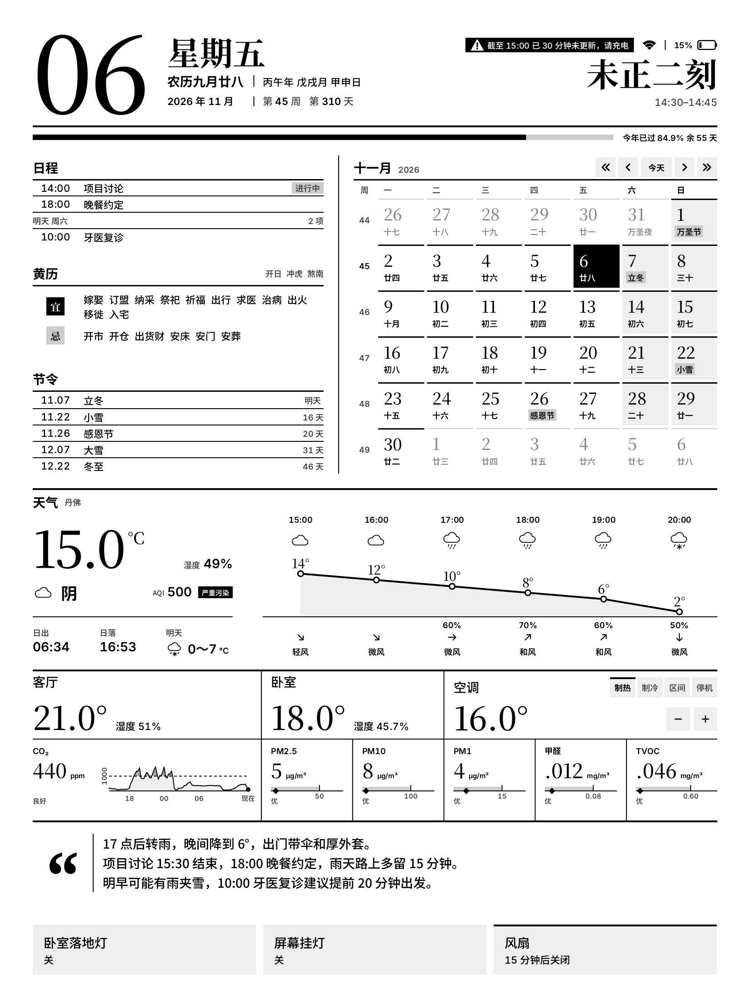

# 刻历 Mono Calendar

[中文](README.md) | English

[](https://github.com/l-ziming/mono-calendar/actions/workflows/check.yml)

This is a little project I work on in my spare time. I wanted a screen next to me for things like the weather, and I happened to have a Sony DPT-RP1 sitting around collecting dust, so I put it to use. Thanks to [HappyZ/dpt-tools](https://github.com/HappyZ/dpt-tools). I'm very much standing on the shoulders of giants here.

There are two parts: Home Assistant and the RP1. Home Assistant collects room and environment data, controls devices, and calls an LLM API to write short notes. The Android app on the RP1 draws the page and handles simple interactions.



The sample was drawn on a desktop with `Page.java`. Current HA App version: 0.10.1 (experimental). You'll need a rooted RP1.

The interface is in Chinese. If you'd like an English version, let me know or [support the project](https://github.com/sponsors/l-ziming).

## Components

| Component | Environment |
| --- | --- |
| RP1 App | Android 5.1 / ARMv7, 1650×2200 grayscale display |
| HA App | Home Assistant App, Node.js 24 (Docker, amd64 / aarch64) |

## Teardown

I couldn't find a public teardown of the DPT-RP1, so I took mine apart and wrote up the hardware in [docs/hardware.md](docs/hardware.md) (Chinese). Hopefully it helps someone else tinkering with the same device.

## Some design choices

- **Why calendars but no reminders**: I wanted iCloud Reminders on the screen too, but since iOS 13, Apple no longer syncs them to third parties over CalDAV. Another route through HA asks for more permissions than I'm comfortable with, so I left it out. I might try another way to sync them when I have the time.
- **Why the clock updates every 15 minutes**: I check my watch, phone or computer when I need the exact time. Less frequent refreshes also help keep screen wear and power use down.

## Layout

```text
ha-app/            Home Assistant App
android/           RP1 app source and resources
deploy/
  home-assistant/  HA package templates (notes and news email)
  standalone/      Deployment without Home Assistant Apps
docs/              Documentation
scripts/           Build, checks, RP1 provisioning and offline preview
tests/             HA, model and display tests, with shared fixtures
```

## Development checks

Run `bash scripts/check.sh` from the repository root with Node.js 24 and Python 3. Set `JAVA_HOME` to JDK 17 to include the Java checks and desktop page rendering. Tests use mock HA and model services; no RP1 or live model calls are needed.

GitHub Actions runs tests on pushes and pull requests. When running the workflow manually, you can also enable Android desktop rendering and download the sample images.

## Work in progress

I'm also working on the RP1's system software. There isn't a ready-to-install release yet:

1. **Too many wake-ups in standby**: the stock firmware checks the network every 20 seconds, keeps mDNS discovery running, and lets through Wi-Fi broadcasts meant for other devices. The CPU keeps waking up, which hurts battery life. The [system changes](docs/rp1-tuning.md) (Chinese) have cut the observed wake-up rate by more than half.
2. **Occasional hangs after standby**: the Wi-Fi driver can time out while checking the wake reason, leaving the screen stuck until I press RESET. I'm testing a fix for the driver's timeout and wait handling.

## License

- **Code**: [PolyForm Noncommercial 1.0.0](LICENSE). Free to use, modify and share for personal, learning, research and non-profit purposes, keeping the `Required Notice` lines in [NOTICE](NOTICE).
- **Visual design, icons and sample images**: [CC BY-NC 4.0](LICENSE-DESIGN.md). Works that use or adapt the design must show "Design based on 刻历 by liziming" in their interface.
- **Commercial use** (selling preinstalled devices, paid apps, commercial services, etc.) requires a separate license from the author; please get in touch through this repository's GitHub Issues.
- **Third-party components** keep their own licenses: Chinese calendar dates, solar terms and almanac data use the vendored [chinese_calendar](ha-app/server/vendor/chinese_calendar.mjs), with its [source notes](ha-app/server/vendor/CHINESE_CALENDAR.md) and [MIT license](ha-app/server/vendor/LICENSE.chinese_calendar); Markdown rendering uses [streaming-markdown](ha-app/server/vendor/STREAMING_MARKDOWN.md), under its [MIT license](ha-app/server/vendor/LICENSE.streaming-markdown); font licenses are in [android/assets/fonts/](android/assets/fonts/).
