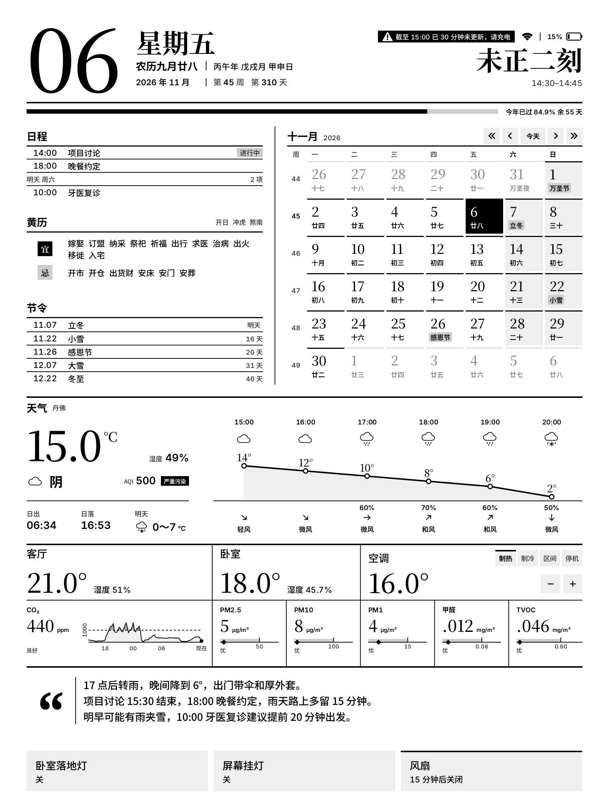

# 刻历

中文 | [English](README.en.md)

[](https://github.com/l-ziming/mono-calendar/actions/workflows/check.yml)
[](LICENSE)
[](LICENSE-DESIGN.md)
[](ha-app/DOCS.md)
[](docs/hardware.md)

这是我闲暇时间做的一个小玩意。一直希望能有一个放在旁边的屏幕来提示一些基本信息，例如天气什么的；刚好手头也有一个索尼的电子纸，DPT-RP1，一直吃灰所以用起来了。

项目分为两部分：Home Assistant 与墨水屏（RP1）。Home Assistant 负责汇总房间与环境状态、控制设备，并调用 LLM 接口提供商的 API 生成提示；RP1 上的 Android 应用负责绘制页面和简单交互。



样例由 `Page.java` 在桌面绘制。当前版本：HA App 0.10.2（experimental）。这是按我自己的 RP1 与 Home Assistant 环境开发和验证的个人项目，复现需要 root 过的 RP1。

## 组成

| 组件 | 环境 |
| --- | --- |
| RP1 App | Android 5.1 / ARMv7，1650×2200 灰度屏 |
| HA App | Home Assistant App，Node.js 24（Docker，amd64 / aarch64） |

## 拆机资料

目前在网上没有找到 DPT-RP1 的公开拆机资料，所以我把自己的那台拆了，具体整理在 [docs/hardware.md](docs/hardware.md)，希望对同样在折腾这台设备的人有用。

## 一些设计上的考虑

- **为什么只有日历，没有提醒事项**：一开始也想把 iCloud 提醒事项显示在屏幕上，但苹果在 iOS 13 之后不再 CalDAV 同步给第三方。而通过HA的另外一条路要求的权限过大，在这里跳过，或许未来时间和精力允许时会做其他的同步思路。
- **为什么报时是一刻钟（15min）而不是每分钟**：首先对于我来说，手表和手机电脑常开，平时需要看具体时间的时候也会首先看他们。因此并不需要很频繁的刷新。其次是考虑到电子墨水屏幕的寿命与刷新耗电，所以从设计上考量用了一刻钟而非每分钟更新。

## 目录

```text
ha-app/            Home Assistant App
android/           DPT-RP1 端的 App 源码和资源
deploy/
  home-assistant/  HA packages 模板（便条实体、新闻邮件）
  standalone/      不使用 HA Apps 时的部署
docs/              文档
scripts/           构建、检查、RP1 配置与离线预览
tests/             回归测试：ha-app/ 模拟 HA 与模型，android/ 屏幕端检查，fixtures/ 共用数据
```

## 开发检查

在仓库根目录运行 `bash scripts/check.sh`，需要 Node.js 24 和 Python 3。设置 JDK 17 的 `JAVA_HOME` 后，还会运行 Java 检查和桌面页面渲染。测试使用模拟 HA 和模型，不需要连接 RP1 或调用真实模型。

GitHub Actions 会在提交和 PR 时自动运行测试；在 Actions 页手动运行检查时，可以选择 Android 桌面渲染，并下载生成的样例图。

## 正在处理的问题

这个项目有点像在给 RP1 定制一个小系统，所以除了应用本身，我也在做一些系统层面的优化。原厂固件本身有几个问题，目前正在解决，暂时还不提供让其他人快速安装的发布包：

1. **待机唤醒过于频繁**：原厂固件每 20 秒做一次网络检查，常驻 mDNS 设备发现，Wi-Fi 也不过滤与本机无关的广播，待机时 CPU 被反复唤醒，影响续航。已经通过调整检查间隔、停用发现服务、在 Wi-Fi 固件层过滤广播等方式把唤醒率降低了一大半，见 [docs/rp1-tuning.md](docs/rp1-tuning.md)。
2. **待机恢复偶发卡死**：原厂 Wi-Fi 驱动在从待机恢复时查询唤醒原因，偶尔会超时并卡住整个恢复流程，屏幕停止刷新，只能按 RESET。已经定位到驱动中的超时与等待问题，修复版驱动还在验证。

## 致谢

感谢以下项目的作者和维护者：

- [HappyZ/dpt-tools](https://github.com/HappyZ/dpt-tools)：RP1 相关工具与资料。
- [Home Assistant](https://github.com/home-assistant/core) 和 [Node.js](https://github.com/nodejs/node)：家庭设备集成和服务端运行环境。
- [chinese_calendar](ha-app/server/vendor/CHINESE_CALENDAR.md)：农历、节气和宜忌数据，上游为 [6tail/lunar-javascript](https://github.com/6tail/lunar-javascript)，保留其 [MIT 许可](ha-app/server/vendor/LICENSE.chinese_calendar)。
- [streaming-markdown](https://github.com/thetarnav/streaming-markdown)：网页对话中的流式 Markdown 渲染，保留其 [MIT 许可](ha-app/server/vendor/LICENSE.streaming-markdown)。
- [Noto CJK](https://github.com/notofonts/noto-cjk)、[Noto Serif](https://github.com/notofonts/noto-fonts) 和 [Google Fonts](https://github.com/google/fonts)：界面的中文字体与引号字形。
- [Inter](https://github.com/rsms/inter)：界面的西文和数字字体。
- [fontTools](https://github.com/fonttools/fonttools)：字体裁剪、静态实例化和等宽数字处理。
- [Shields.io](https://github.com/badges/shields)：README 中的徽章。

字体的具体来源、处理方式和许可见[字体说明](android/assets/fonts/README.md)。

## 许可

我公开源码是希望同样在折腾 RP1 或者墨水屏的人能修改、自用。而不是倒卖设备的预装功能、捆绑卖点或“免费赠品”，因此保留了商业使用限制。本项目属于源码公开（source-available），所用非商业许可不符合 [OSI 的开源定义](https://opensource.org/osd)。

- **代码**：[PolyForm Noncommercial 1.0.0](LICENSE)。个人、学习、研究和非营利用途可以自由使用、修改和分发，需保留 [NOTICE](NOTICE) 中的 `Required Notice`。
- **视觉设计、图标与样例图**：[CC BY-NC 4.0](LICENSE-DESIGN.md)。使用或改编本设计的作品须在界面上署名「设计基于 刻历 by l-ziming」。
- **商业使用**：将本项目用于设备预装销售、随设备销售附赠或捆绑、营利性代装、定制或托管等商业用途前，需通过本仓库的 GitHub Issues 联系作者，取得单独书面授权。软件不单独收费，不等于用途属于非商业；具体授权范围以各许可证为准。
- **第三方组件**保留各自许可，见[致谢](#致谢)。
